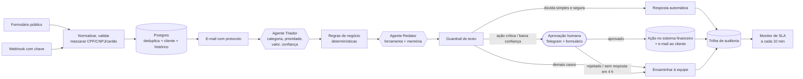
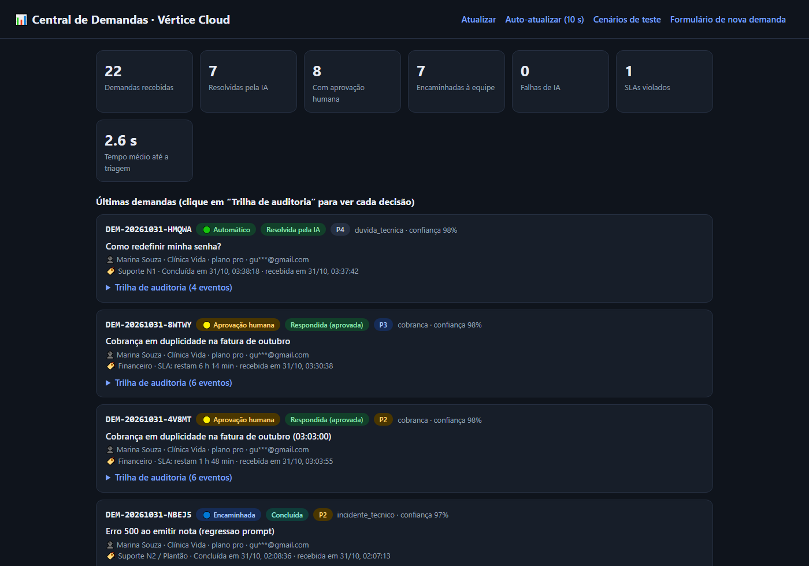
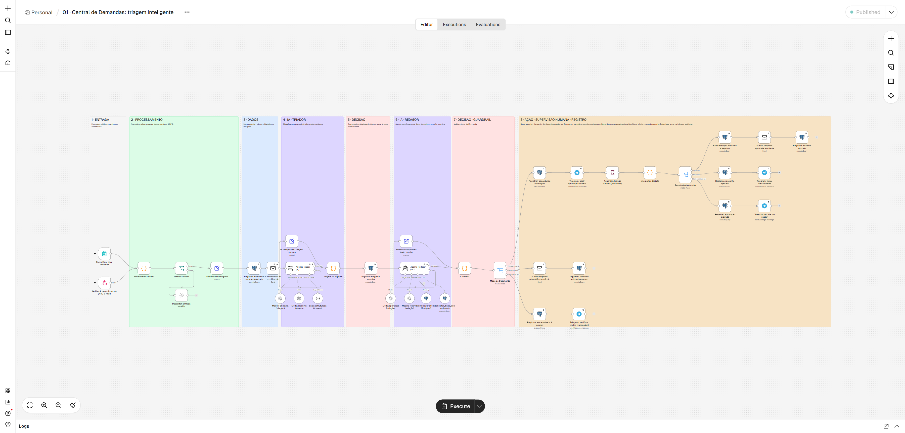
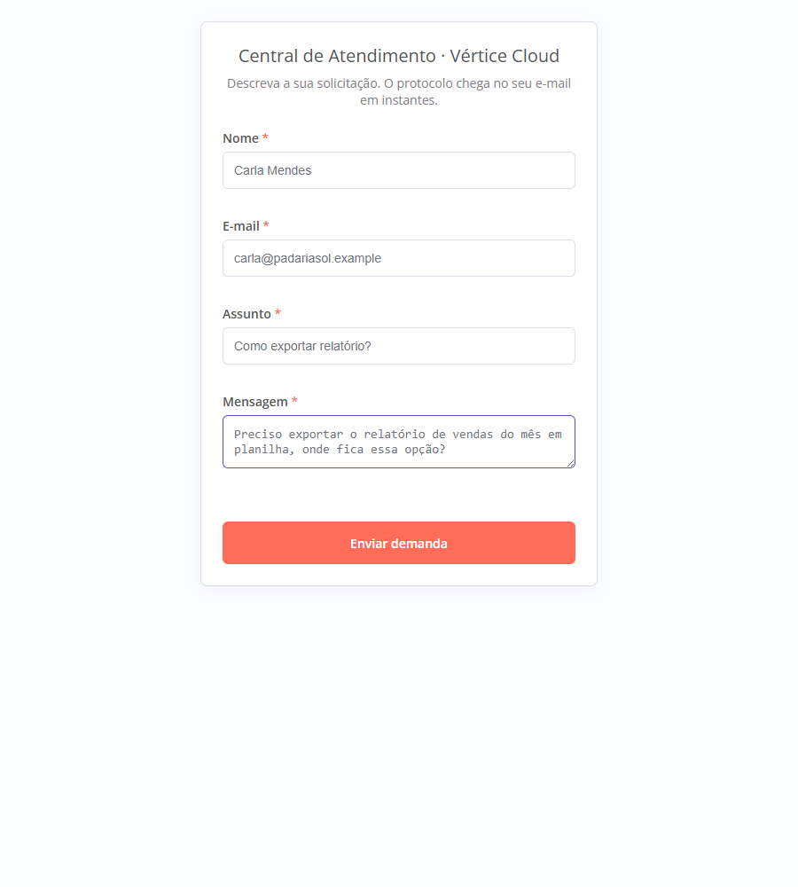
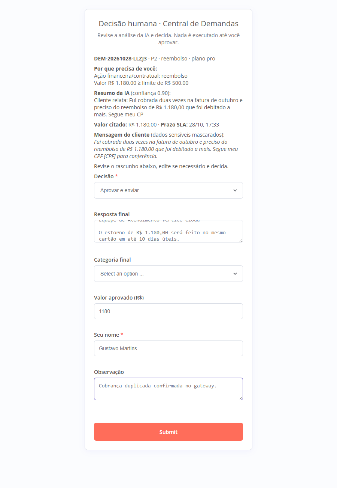
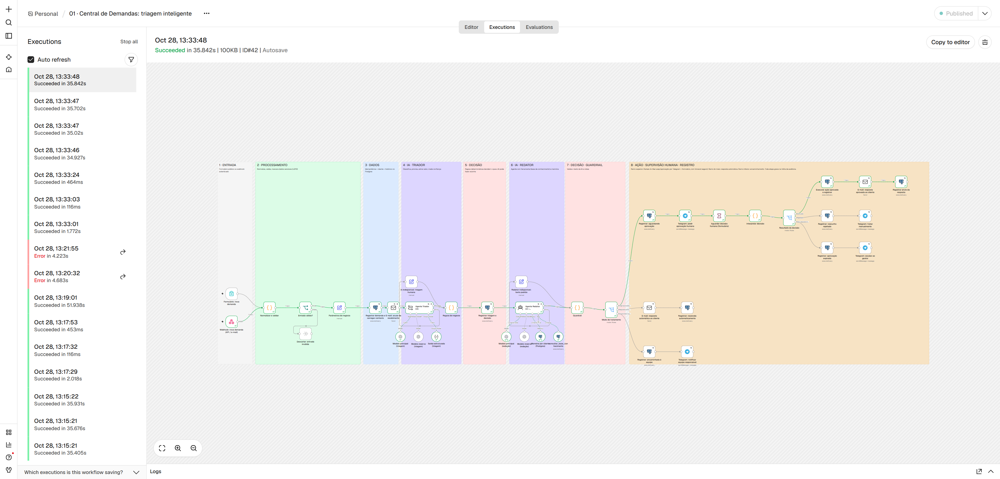
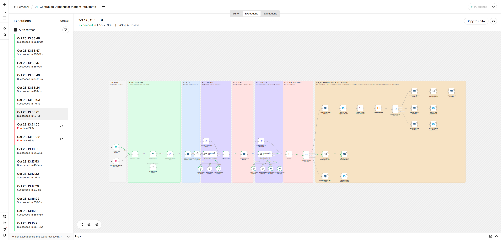
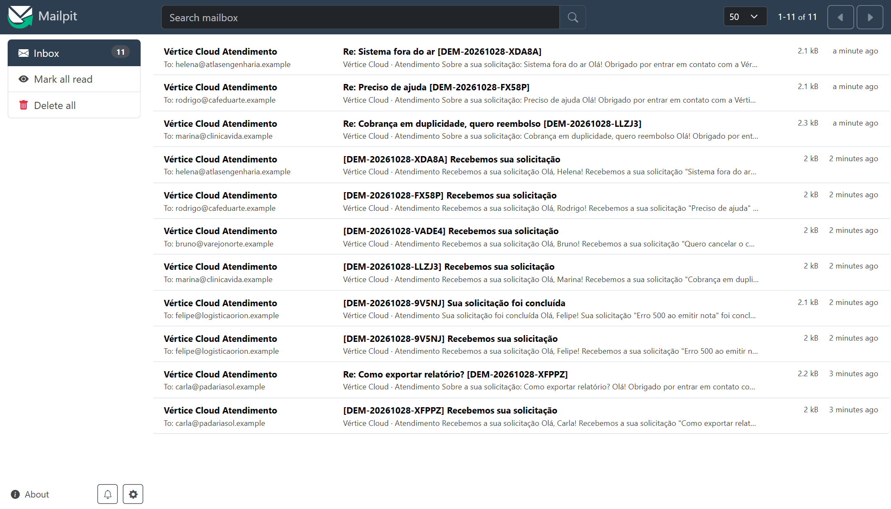
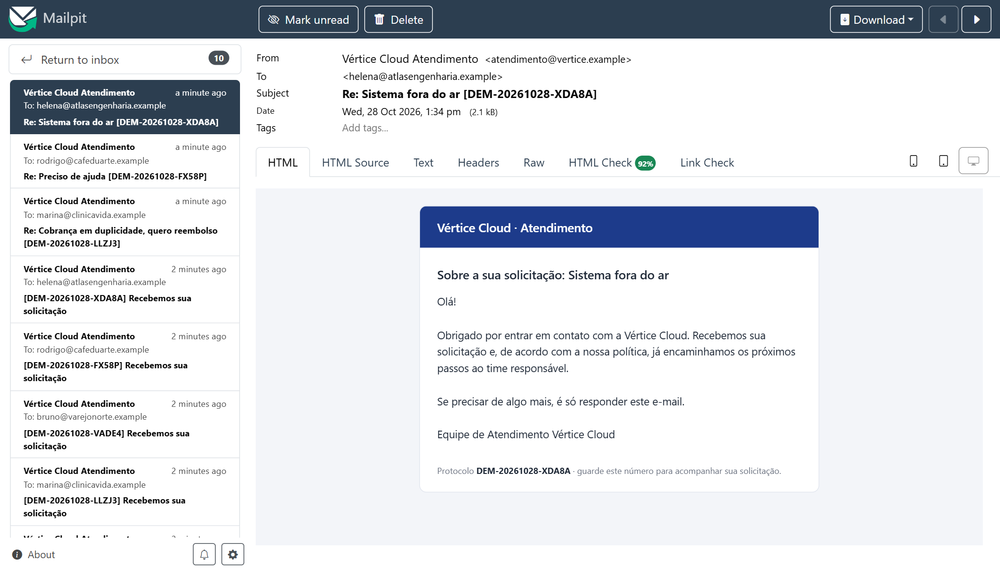

# AI Operations: Central de Demandas Inteligente

> Automação empresarial com **n8n (Low-Code)** e **agentes de IA** que recebe uma demanda de cliente, interpreta, decide o que pode ser automático, **pede aprovação humana nas ações críticas**, executa, registra tudo e acompanha o prazo até a conclusão.

Trabalho da disciplina **Desenvolvimento de Aplicações e Automações com Low Code**.

| | |
|---|---|
| **Demonstração** | <https://aiops.gustavomartins.dev/form/nova-demanda> |
| **Vídeo pitch** | <!-- TODO: link do vídeo --> |
| **Parte teórica** | [docs/parte-teorica.md](docs/parte-teorica.md) |

---

## 1. O problema

A **Vértice Cloud** (empresa fictícia, SaaS B2B) recebe ~1.200 demandas por mês por formulário, e-mail e API. Hoje alguém lê cada mensagem, consulta o cadastro, registra em planilha, decide quem trata e em que prazo, escreve a resposta, pede aprovação ao financeiro quando envolve dinheiro e acompanha o prazo de cabeça. Isso gera demora na primeira resposta, retrabalho, decisões inconsistentes e nenhuma rastreabilidade.

**A automação** assume as partes repetitivas e de interpretação de texto, e **mantém uma pessoa onde há dinheiro, contrato, risco ou dúvida da IA**.

```
Entrada → Processamento → Dados → IA → Decisão → Ação → Supervisão → Registro
```

## 2. Arquitetura



### Os 4 workflows ([workflows/](workflows/))

| Arquivo | O que faz |
|---|---|
| `01-triagem-de-demandas.json` | **Principal (47 nós).** Entrada → triagem por IA → regras → redação por IA → guardrail → aprovação humana / resposta automática / encaminhamento |
| `02-monitor-de-sla.json` | A cada 10 min alerta demandas com menos de 20% do prazo e as que estouraram o SLA |
| `03-concluir-demanda.json` | Formulário para a equipe encerrar a demanda e avisar o cliente |
| `99-tratamento-de-erros.json` | *Error Workflow* dos três acima: alerta no Telegram e grava na trilha |

### O que cada etapa usa

| Etapa | Nós do n8n |
|---|---|
| **Entrada** | Form Trigger, Webhook (autenticação por cabeçalho `X-API-Key`) |
| **Processamento** | Code (unifica, valida, gera protocolo, **mascara dados sensíveis**), If |
| **Dados** | Postgres (deduplicação em 24 h, cadastro e histórico do cliente), Gmail (acuse; Send Email/SMTP no ambiente local) |
| **IA** | Basic LLM Chain + Structured Output Parser (Triador); **AI Agent** + Postgres Tool + Postgres Chat Memory (Redator); OpenAI Chat Model com **modelo reserva** |
| **Decisão** | Code (regras e guardrail), Switch |
| **Ação** | Postgres, Gmail (Send Email/SMTP no ambiente local), Telegram |
| **Supervisão** | **Wait (formulário)** com timeout, Telegram |
| **Registro** | Postgres (`eventos_demanda`, append-only), Schedule Trigger, Error Trigger |

## 3. Onde a IA atua (e onde não atua)

| Agente | Função | Entrada | Saída |
|---|---|---|---|
| **Triador** | Interpretar e classificar | Texto **mascarado** + plano, situação e histórico do cliente | JSON validado: categoria, prioridade, sentimento, resumo, valor citado, **confiança 0–1**, risco jurídico, "resposta automática segura?" |
| **Redator** | Recomendar e gerar | Resumo + mensagem mascarada; **consulta a base de conhecimento** (ferramenta SQL) e lembra do cliente (memória) | Rascunho de resposta em português |

**A IA não decide** SLA, roteamento, se algo é enviado sem revisão, nem executa ações financeiras. Isso é feito por regras determinísticas (nó "Regras de negócio") e por um guardrail sobre o texto gerado.

### Regras que decidem o caminho

| Condição | Caminho |
|---|---|
| Reembolso ou cancelamento · valor ≥ R$ 500 · risco jurídico · cliente Enterprise com P1 | **Aprovação humana** |
| Confiança da IA < 0,65 | **Aprovação humana** (revisa a classificação) |
| `duvida_tecnica` ou `elogio_sugestao`, confiança ≥ 0,85, P3/P4, cliente não inadimplente, IA marcou como segura **e** guardrail aprovou o texto | **Resposta automática** |
| Qualquer outro caso, ou IA indisponível | **Encaminhar à equipe** com resumo e rascunho |

Os limites ficam no nó **"Parâmetros de negócio"** do canvas.

## 4. Human-in-the-Loop

Quando a regra exige aprovação, o workflow **pausa** (nó *Wait*):

1. O aprovador recebe no **Telegram** o resumo, o plano, a prioridade, o SLA e os motivos, com um link assinado.
2. O link abre um **formulário de decisão** com a mensagem do cliente (já mascarada), a análise da IA e o **rascunho editável**. O humano pode aprovar (editando o texto, corrigindo a categoria e definindo o valor) ou rejeitar.
3. **Aprovado:** grava a ação em `acoes_financeiras`, envia o e-mail e registra quem aprovou e se editou o texto.
4. **Rejeitado:** nada é enviado ao cliente; a equipe é avisada para tratar manualmente.
5. **Sem resposta em 4 h:** escala ao gestor e **nenhuma ação é executada**.

## 5. Tratamento de erros

| Situação | O que acontece |
|---|---|
| Entrada inválida ou duplicada (24 h) | Descartada sem criar demanda |
| IA principal falha | Tenta o **modelo reserva**; se falhar, a demanda vai para **triagem humana** |
| Redator falha | Texto padrão, nunca enviado automaticamente |
| Guardrail reprova o texto | Rebaixa de "automático" para "encaminhar" |
| Banco, e-mail ou Telegram falham | 3 tentativas; depois o *Error Workflow* alerta o gestor |
| Acuse de recebimento falha | Não bloqueia a triagem |

## 6. Segurança e privacidade (resumo)

- CPF, CNPJ e cartão são **mascarados antes de ir para o LLM**; nome e e-mail do cliente não vão ao Triador.
- O texto do cliente é tratado como **dado não confiável** (defesa contra injeção de prompt); quem decide é a regra, não o modelo.
- Webhook exige chave; formulários públicos têm **limite de requisições** no Traefik; links de aprovação são **assinados**.
- SQL **parametrizado**; HTML do cliente é **escapado** no formulário de aprovação e no Telegram.
- O n8n acessa o banco com um papel de **privilégio mínimo** (sem DELETE/DDL, trilha de auditoria só de inserção).
- Segredos nas *Credentials* do n8n (criptografadas); execuções apagadas após 14 dias em produção.

Detalhes em [docs/parte-teorica.md](docs/parte-teorica.md#7-riscos-segurança-privacidade-e-tratamento-de-falhas).

---

## 7. Como rodar

Requisitos: **Docker** e **Node.js 20+**.

### 7.1 Sem nenhuma chave (OpenAI e Telegram simulados, e-mails no Mailpit)

```bash
scripts/dev-up.sh mock
```

O script sobe n8n + Postgres + Mailpit + mocks, cria o usuário dono, importa as credenciais e os 4 workflows e os publica.

| O quê | Onde |
|---|---|
| n8n | <http://localhost:5678> (`dev@example.com` / `DevOps12345`) |
| Formulário de nova demanda | <http://localhost:5678/form/nova-demanda> |
| Formulário de encerramento | <http://localhost:5678/form/concluir-demanda> |
| E-mails enviados | <http://localhost:8025> (Mailpit) |
| Mensagens "do Telegram" | `curl http://localhost:4010/telegram/messages` (o link de aprovação está dentro do texto) |

> No modo `mock` a "IA" é um servidor de teste que classifica por palavras-chave. Ele só verifica o encanamento do fluxo (nós, ramos, banco, e-mail). **A qualidade real da IA só aparece no modo `real`.**

### 7.2 Com serviços reais

```bash
export OPENAI_API_KEY=sk-...
export TELEGRAM_BOT_TOKEN=123456:ABC...        # crie o bot no @BotFather
export APROVADOR_TELEGRAM_CHAT_ID=...          # seu chat_id (veja o bot @userinfobot)
export GESTOR_TELEGRAM_CHAT_ID=...
export SMTP_HOST=smtp.exemplo.com SMTP_PORT=587 SMTP_USER=... SMTP_PASSWORD=...
export WEBHOOK_API_KEY=$(openssl rand -hex 16)
scripts/dev-up.sh real
```

Antes de enviar a primeira mensagem ao seu bot, abra uma conversa com ele no Telegram e envie `/start` (um bot só consegue escrever para quem falou com ele primeiro). Em modo real, o remetente dos e-mails fica em `EMAIL_REMETENTE` no `docker-compose.dev.yml`.

### 7.3 Testar o fluxo

**Pelo formulário:** abra <http://localhost:5678/form/nova-demanda>, por exemplo com `marina@clinicavida.example` (cliente Pro): assunto "Reembolso em duplicidade" e mensagem "Fui cobrada duas vezes e quero o reembolso de R$ 1.180,00". Você deve receber o protocolo por e-mail, depois a mensagem de aprovação no Telegram; abra o link, edite o rascunho e aprove.

**Pela API:**

```bash
curl -X POST http://localhost:5678/webhook/demanda \
  -H 'Content-Type: application/json' -H 'X-API-Key: dev-webhook-key' \
  -d '{"nome":"Carla Mendes","email":"carla@padariasol.example","assunto":"Como redefinir minha senha?","mensagem":"Esqueci minha senha de acesso. Como faço para redefinir?"}'
```

**Casos prontos** ([tests/casos.json](tests/casos.json)): 10 cenários (dúvida simples, reembolso com CPF, incidente P1 Enterprise, cancelamento, baixa confiança, falha da IA, guardrail, entrada inválida...). Envia todos e confere o resultado no banco:

```bash
node tests/enviar-casos.mjs               # modo mock
node tests/enviar-casos.mjs --sem-mock    # com serviços reais (pula os casos que dependem do mock)
```

**Clientes de exemplo** (banco `ops`): `carla@padariasol.example` (Starter), `rodrigo@cafeduarte.example` (Starter, inadimplente), `marina@clinicavida.example` e `felipe@logisticaorion.example` (Pro), `helena@atlasengenharia.example` e `bruno@varejonorte.example` (Enterprise). Para testar com o **seu** e-mail e receber as respostas de verdade:

```bash
docker compose -f docker-compose.dev.yml exec db psql -U postgres -d ops -c \
  "insert into clientes (email, nome, empresa, plano, mrr_brl, gerente_conta) values ('seu@email.com','Seu Nome','Sua Empresa','enterprise',2400,'Fulano')"
```

### 7.4 Observabilidade

Toda etapa grava um evento. A trilha de uma demanda:

```sql
select criado_em, etapa, ator, detalhes
from eventos_demanda where protocolo = 'DEM-...' order by id;
```

Indicadores da operação:

```sql
select * from v_kpis;   -- % resolvido por IA, % com aprovação humana, falhas de IA, SLAs violados, segundos até a triagem
```

Além disso o n8n guarda cada execução com os dados de entrada e saída de todos os nós.

---

## 8. Deploy (VPS com Docker Swarm + Traefik + Portainer)

1. Faça *push* na `main`: o GitHub Actions publica a imagem do banco em `ghcr.io/gustavo9br/ai-operations-db`. (O n8n usa a imagem oficial.)
2. Copie `vps.env.example` para `vps.env`, gere os segredos (`openssl rand -hex 24`) e preencha os `chat_id` do Telegram.
3. No Portainer: **Stacks → Add stack → Web editor**, cole `docker-compose.prod.yml` e em *Environment variables* use **Load variables from .env file** com o `vps.env`.
4. Abra `https://aiops.gustavomartins.dev`, crie o usuário dono do n8n e cadastre as **6 credenciais** (nomes exatos): `Ops Postgres` e `Ops Postgres (memória)` (host `db`, banco `ops`, usuários `ops_app` e `ops_memoria`), `OpenAI (Ops)`, `SMTP (Ops)` (ou, como na produção atual, uma credencial `Gmail account` OAuth2 nos nós de e-mail), `Telegram Bot (Ops)` e `Webhook API Key (Ops)` (Header Auth, nome `X-API-Key`).
5. **Workflows → Import from file** com os 4 arquivos de [workflows/](workflows/) e abra cada nó marcado em vermelho para selecionar a credencial. **Publique os 4** (o de erros também, senão ele não dispara).

> Alternativa por linha de comando, sem clicar: `scripts/seed-credentials.mjs` + `scripts/importar-no-n8n.sh <container> <credenciais.json>` (o mesmo caminho usado no ambiente local).
>
> Os pacotes do GHCR podem precisar ser tornados públicos para a VPS conseguir baixar a imagem do banco.

## 9. Prints

### Em produção (IA, Telegram e Gmail reais)

Painel somente leitura do ambiente em produção (`aiops.gustavomartins.dev`), gerado por um workflow de apoio do próprio n8n. Mostra os indicadores medidos (incluindo o **tempo médio de 2,6 s até a triagem**) e as demandas reais processadas, cada uma com o caminho decidido (🟢 automático, 🟡 aprovação humana, 🔵 encaminhada), o status e a trilha de auditoria. Os e-mails aparecem parcialmente ocultos.



Nesta execução em produção foram verificados, com serviços reais: classificação pela IA, resposta automática, pausa para aprovação humana (aprovar e rejeitar), regras por plano de cliente (Enterprise com P1 e cliente inadimplente), tentativa de *prompt injection*, encerramento de demanda, alerta de SLA disparado pelo monitor e o *Error Workflow*. Os casos de teste e o que cada um deve provocar estão descritos na seção 7.3.

### No ambiente de desenvolvimento (IA simulada)

> As telas abaixo foram geradas no ambiente de desenvolvimento **com a IA simulada**: elas mostram a orquestração real, mas não a qualidade da IA.

**Canvas do workflow principal**, com as 8 etapas do enunciado como faixas coloridas:



| Formulário público de nova demanda | Formulário de decisão humana (Human-in-the-Loop) |
|---|---|
|  |  |

**Execução de um reembolso**, de ponta a ponta, com a pausa para aprovação humana e a ação executada (caminho verde):



**Execução de uma dúvida simples**, resolvida pela IA sem intervenção humana:



| E-mails recebidos pelo cliente (Mailpit) | Resposta ao cliente |
|---|---|
|  |  |

Demais workflows: [monitor de SLA](docs/prints/07-workflow-sla.png) · [concluir demanda](docs/prints/08-workflow-concluir.png) · [tratamento de erros](docs/prints/09-workflow-erros.png) · [formulário de encerramento](docs/prints/10-formulario-concluir.png).

<!-- Falta apenas, se quiser: um print da mensagem de aprovação no Telegram real. -->

## 10. Estrutura

```
workflows/            os 4 workflows do n8n (JSON exportado)
db/                   Dockerfile do Postgres + esquema, dados de exemplo e papéis
scripts/              dev-up.sh, importar-no-n8n.sh, seed-credentials.mjs
tests/                casos de teste + mock de OpenAI/Telegram
docs/                 parte teórica, roteiro do vídeo e prints
docker-compose.dev.yml    ambiente local
docker-compose.prod.yml   stack do Swarm (sem segredos, tudo por variável)
vps.env.example           variáveis de produção
.github/workflows/        build da imagem do banco
```

## 11. Limitações conhecidas

- A **qualidade da IA** não foi medida com o modelo real; o fluxo foi validado de ponta a ponta com um servidor de IA simulado. Ajuste os prompts (nós "Agente Triador" e "Agente Redator") com demandas reais.
- O **SLA** é contado em horas corridas, não em horário comercial.
- A **aprovação por Telegram** usa identidade declarada ("Seu nome"). Em produção, o ideal é proteger o formulário com login.
- As notificações de todas as equipes vão para o mesmo chat; em produção, um chat por equipe.
- O **reembolso** é registrado na tabela `acoes_financeiras` (um "sistema interno" simulado); a integração com um gateway de pagamento de verdade não está incluída.
